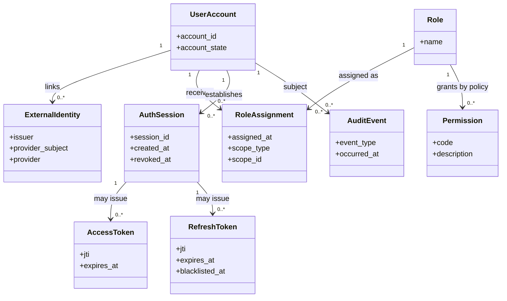

# 01 - IAM Domain Model

**Status:** Draft for review  
**Parent:** [IAM Architecture](README.md)

## 1. Purpose

Define the concepts and relationships used to reason about identity and access in AMS. This is a conceptual domain model, not a declaration that each concept must be implemented as a separate Django model or database table.

## 2. Domain boundaries

Django owns AMS accounts, external-identity associations, account states, role assignments, permission evaluation, and AMS token issuance. Google owns the authentication event and the OIDC subject it asserts. Google does not own AMS roles or AMS authorization decisions.

## 3. Core concepts

| Concept | Meaning | Authority / notes |
|---|---|---|
| User account | An account recognized by AMS and used as the principal for AMS access. | Managed by Django. |
| External identity | A verified identity at an external provider, identified by provider/issuer and provider subject. | Linked to an AMS account only by a backend-verified flow. |
| Role | A named responsibility category such as Student, Lecturer, Administrator, or HOD. | Defined and assigned by AMS. |
| Role assignment | The association of an account with a role, optionally constrained to an organizational/resource scope. | Must be managed by authorized backend operations. |
| Permission | A named capability to perform an operation. | Enforced by Django; not inferred from UI visibility. |
| Role-permission grant | A policy association describing which permissions a role can receive. | Must support least privilege and explicit delegation. |
| Authentication session | A logical period of authenticated use, with issuance, expiry, and termination events. | Session persistence/device tracking details require implementation confirmation. |
| Access token | Short-lived JWT presented to protected APIs. | Issued and validated according to backend policy. |
| Refresh token | Longer-lived JWT used to obtain a replacement access/refresh pair. | Rotated; previous token is rejected/blacklisted after successful rotation. |
| Account state | Whether the account is provisioned, pending activation/registration, active, suspended, or otherwise restricted. | Exact state enumeration and transitions must be finalized in the account lifecycle implementation. |
| Audit event | A security-relevant record such as authentication outcome, identity linking, role change, or revocation. | Must exclude credentials and token contents. |

## 4. Conceptual relationships

The diagram expresses conceptual relationships. In particular, whether AMS persists an `AuthSession` record and directly associates token JTIs with it is an implementation/design detail to confirm. JWTs are credentials, not themselves proof that a separate server-side session table exists.

## 5. External identity key and linking rules

- Identify a Google identity using the verified OIDC issuer and stable `sub` subject. The provider/issuer must be part of the identity namespace; do not assume a subject is globally unique across all providers.
- Enforce uniqueness of the Google subject within its issuer/provider namespace.
- Do not use email address, display name, avatar, or client-supplied profile fields as proof that an external identity owns an AMS account.
- A verified identity may be linked only through an eligible student registration flow or the lecturer activation flow for an already provisioned lecturer account.
- Identity linking must be atomic and reject attempts to link an external identity already associated with another AMS account.
- Account linking, unlinking, and replacement must be auditable and protected against unauthorized takeover.

## 6. Role model

The initial role set contains four distinct roles:

| Role | High-level responsibility |
|---|---|
| Student | Access student capabilities and the student's own permitted academic/attendance resources. |
| Lecturer | Manage permitted teaching, course, and session resources within assigned scope. |
| Administrator | Perform explicitly authorized system-administration and account-provisioning operations. |
| HOD | Perform departmental oversight and approval workflows, including relevant absence/excuse decisions. |

An account may hold more than one role. Role assignment is an AMS administrative decision, not a claim accepted from Google or a Flutter client.

Roles are not automatically hierarchical. In particular, HOD is not a synonym for Administrator and does not inherit every Administrator permission. If an HOD needs a particular administrative capability, grant that permission explicitly and constrain it to the appropriate organizational scope.

## 7. Account lifecycle concepts

The domain must distinguish at least these business situations:

1. **Student identity not yet associated:** Google identity is verified, but no eligible AMS student account is linked. The backend determines whether registration may proceed.
2. **Student registration pending:** additional AMS registration data or eligibility checks are required. This is not yet an authenticated, fully registered student account.
3. **Lecturer provisioned:** an authorized administrator has created the lecturer's AMS account, but the lecturer has not yet linked a verified Google identity/activated access.
4. **Active account:** the account is eligible to authenticate, subject to role and resource authorization.
5. **Restricted account:** suspended, deactivated, or otherwise blocked from authentication or specified operations.

The exact state names, transition rules, and any mandatory-password-change state must be aligned with the existing AMS user model and account lifecycle requirements before implementation is finalized.

## 8. Domain invariants

1. One external identity in the Google issuer namespace cannot be linked to multiple AMS accounts.
2. Email equality alone never authorizes account linking.
3. A student cannot acquire the Lecturer role through student registration.
4. Lecturer activation cannot create a lecturer account; it can only activate/link an already provisioned eligible account.
5. A client cannot assign or elevate its own roles.
6. Multiple role assignments do not bypass permission or object-scope checks.
7. Inactive or restricted accounts cannot obtain or continue using authorization beyond the account-state policy.
8. Revoked/blacklisted refresh tokens cannot be used to obtain new token pairs.
9. A valid authentication token does not imply permission to access every AMS resource.
10. Security-sensitive identity and role changes must be auditable without logging secrets.

## 9. Open design details

- Confirm the canonical account-state enumeration and transitions against the Django user model.
- Confirm whether role assignments are global, scoped, or a combination. HOD permissions should be scoped to the relevant department; lecturer permissions should be scoped to assigned teaching resources where applicable.
- Confirm whether the initial implementation persists a first-class session/device record or relies on refresh-token blacklist records plus audit events.
- Define controlled identity unlinking/replacement and recovery procedures.
