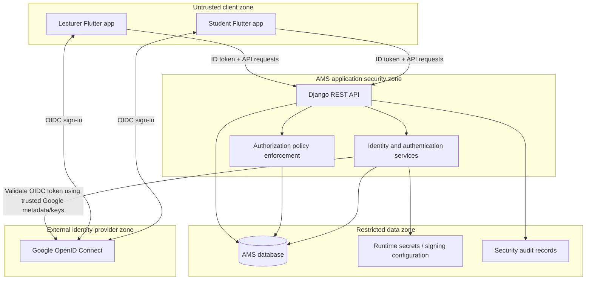

# 02 - Trust Boundaries and Security Architecture

**Status:** Draft for review  
**Parent:** [IAM Architecture](README.md)

## 1. Purpose

Identify the AMS security zones, trust relationships, and enforcement responsibilities. A trust boundary is a point where data or credentials cross from one security context into another and must be validated before use.

## 2. System context and trust zones

The diagram is logical. Google ID-token signature validation can use Google's published signing keys and trusted OIDC metadata, with appropriate caching; it does not imply that Django must make a live Google API request for every authentication.

## 3. Trust zones

| Zone | Components | Trust classification |
|---|---|---|
| External identity provider | Google OIDC | External authority for Google authentication assertions; not authoritative for AMS roles or account eligibility. |
| Client | Student and Lecturer Flutter applications, device storage, client runtime | Untrusted/public clients. A device or app may be modified or compromised. |
| AMS application | Django API, IAM services, authorization policies | Authoritative application security enforcement zone. |
| Restricted data/infrastructure | Database, signing keys, runtime secrets, audit storage | Restricted resources accessible only to authorized backend/runtime identities. |

## 4. Boundary crossings and required controls

### 4.1 Flutter to Google

The user authenticates through the Google-supported mobile sign-in flow. The app receives a Google ID token for submission to the backend.

Controls:
- Use the approved Android/iOS OAuth client configuration and expected token audience(s).
- Use maintained Google sign-in/OIDC libraries.
- Do not embed confidential client secrets in Flutter.
- Treat all client-returned profile fields as display/input data, not proof of identity.
- Protect the device's local AMS tokens using platform-appropriate secure storage.

### 4.2 Flutter to Django

All client requests cross an untrusted boundary.

Controls:
- Require HTTPS in deployed environments.
- Validate authentication tokens on protected endpoints.
- Validate request data server-side; never trust client-supplied user IDs, roles, account states, or ownership assertions.
- Apply authentication, authorization, rate limiting, and safe error handling at the backend.
- Enforce object-level authorization for every resource lookup or mutation.
- Do not rely on Flutter navigation guards or hidden UI controls as security controls.
- Do not log passwords, Google ID tokens, AMS access/refresh tokens, activation credentials, or sensitive request bodies.

### 4.3 Google to Django identity assertion

Django accepts a Google identity only after verifying the ID token.

At minimum validate:
- Cryptographic signature against trusted Google signing keys.
- Issuer (`iss`).
- Audience (`aud`) against the configured client ID(s) intended for this application.
- Expiration (`exp`) and relevant time claims.
- Nonce when the authentication request used a nonce.
- The expected token type/flow and any additional applicable OIDC constraints.

Use the verified `sub` as the stable external subject. Do not link accounts using email alone. Treat claims such as email verification as attributes subject to explicit policy, not as a replacement for subject verification.

### 4.4 Django to database and secrets

The database and signing configuration are restricted resources.

Controls:
- Restrict database network access and credentials to required services.
- Use separate environment-specific credentials and configuration.
- Keep secrets, private keys, and populated environment files out of source control.
- Load production secrets from the deployment environment/secret-management facility, not development dotenv files.
- Apply least-privilege database/runtime permissions.
- Back up and protect audit records according to operational policy.

## 5. Authority and responsibility matrix

| Security decision | Authority / enforcement point |
|---|---|
| Authenticate a Google user | Google performs authentication; Django independently verifies the resulting OIDC assertion. |
| Establish an AMS account | Django, according to student registration or administrator provisioning policy. |
| Link Google identity to AMS account | Django after verified OIDC evidence and account-flow checks. |
| Determine account state | Django/database. |
| Assign AMS roles | Authorized AMS administration/backend workflows. |
| Grant and evaluate permissions | Django authorization policy. |
| Enforce resource ownership/scope | Django API/service/query layer. |
| Issue AMS access and refresh JWTs | Django. |
| Validate AMS API credentials | Django. |
| Present authentication UI and locally store tokens | Flutter, without authority to grant access. |
| Decide Google identity claims | Google, subject to Django token verification. |

## 6. Threat assumptions

The architecture assumes:
- A mobile client can be reverse-engineered, modified, or run in an instrumented environment.
- Requests can be replayed, altered, or sent outside the official application.
- A user can manipulate identifiers and request resources belonging to another user.
- A Google ID token can be expired, malformed, intended for a different audience, or otherwise invalid.
- A device may be lost or compromised, exposing locally stored credentials.
- Credentials and secrets committed to a public repository must be treated as compromised.

The backend must remain secure even when a client behaves maliciously.

## 7. Trust-boundary rules

1. Never trust a role, permission, account state, or ownership claim supplied by Flutter.
2. Never treat Google email as a sufficient account-linking key.
3. Never accept a Google ID token without full server-side validation.
4. Never allow authentication to bypass AMS account eligibility.
5. Never allow a valid JWT to bypass endpoint or object-level authorization.
6. Never expose signing keys, provider secrets, activation tokens, or AMS tokens in logs or repository history.
7. Return safe authentication errors that do not reveal whether a particular account exists.

## 8. Related security work

See [#42 - Rotate exposed credentials and secure lecturer provisioning](https://github.com/GeinoX/ams-backend/issues/42), [#44 - Architecture and security foundations](https://github.com/GeinoX/ams-backend/issues/44), and [#50 - Security, audit, end-to-end verification, and release](https://github.com/GeinoX/ams-backend/issues/50).
