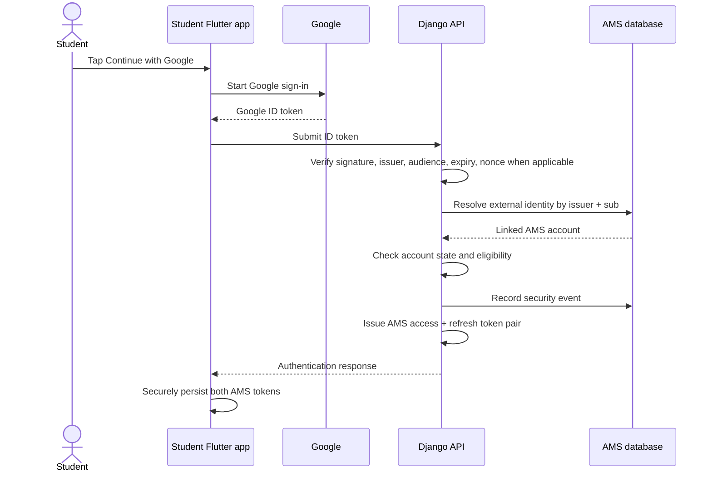
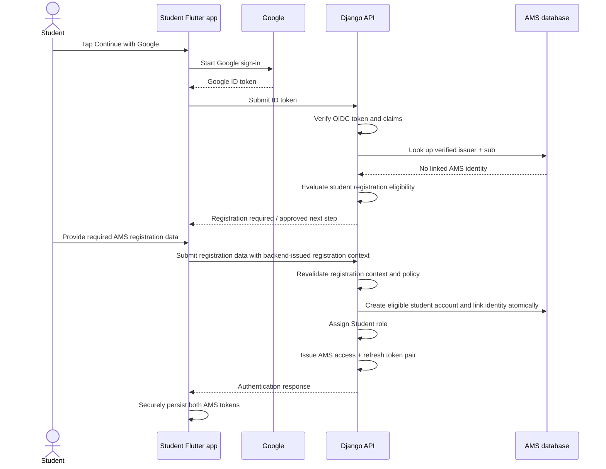
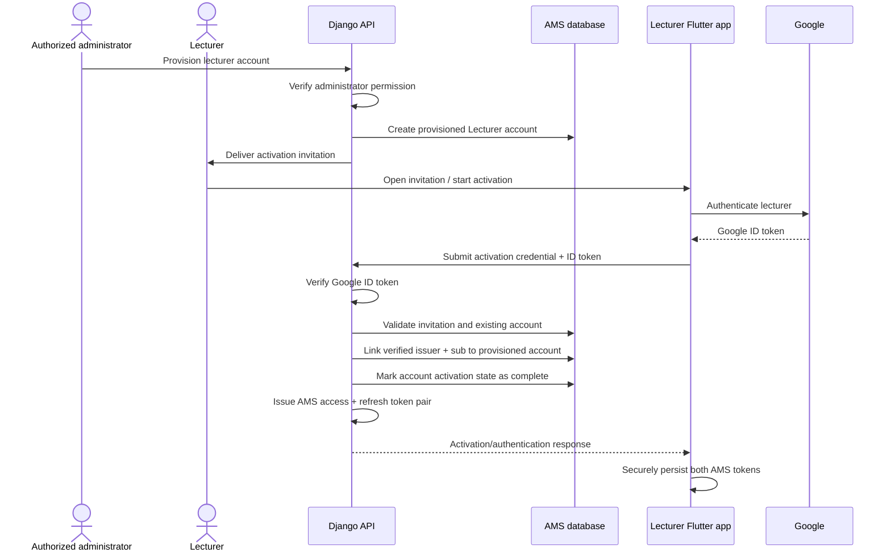

# 03 - Authentication and Account Activation Flows

**Status:** Draft for review  
**Parent:** [IAM Architecture](README.md)

## 1. Purpose

Describe how a person establishes an AMS identity using Google OIDC, how student registration is completed, and how a provisioned lecturer activates an existing account.

These are logical flows. Endpoint names and request/response schemas must be finalized in the backend API contract and must not be inferred from these diagrams.

## 2. Actors and responsibilities

- **Student Flutter app:** starts Google sign-in, submits the Google ID token, and collects additional registration data only when the backend requires it.
- **Lecturer Flutter app:** starts Google sign-in and submits activation evidence for an existing provisioned account.
- **Google:** authenticates the user and issues an OIDC ID token.
- **Django:** validates the ID token, resolves account eligibility, links identities, applies account-state rules, and issues AMS tokens only after successful AMS authentication.
- **Administrator:** creates the lecturer's AMS account before activation.
- **Database:** stores AMS accounts, external identity links, role assignments, and relevant lifecycle/audit state.

## 3. Student Google authentication and registration

### 3.1 Existing student account

### 3.2 New student requiring registration

**Important:** the diagram's “backend-issued registration context” is a proposed secure API design detail. The exact mechanism, expiry, binding to the verified Google subject, and registration endpoint contract must be confirmed. The client must not be able to substitute a different identity during registration.

Rules:
- The backend, not the Flutter app, decides whether registration is required and whether it may proceed.
- Do not silently create an incomplete student account and treat it as fully authenticated.
- Do not grant the Student role until the backend's registration and eligibility rules are satisfied.
- Create the account and external identity association atomically, with uniqueness protection.
- Do not permit student registration to create or request a Lecturer, HOD, or Administrator role.

## 4. Lecturer account provisioning and activation

A lecturer account must exist before activation. Lecturer activation links a verified Google identity to that existing account; it is not a registration flow.

Security requirements for the activation invitation:
- It must identify or securely reference an existing provisioned lecturer account.
- It must be unpredictable, time-limited, single-use, and protected against replay.
- It must not itself be treated as proof of Google identity; the Google ID token is separately verified.
- It must not permit the client to choose an arbitrary account to claim.
- Store only a protected representation of the activation secret where practical; never log or expose it.
- Consume the invitation atomically with successful identity linking.
- Reject an account that is already activated or whose state no longer permits activation.

The precise invitation delivery, token storage, expiry, and recovery policy must be finalized in the account lifecycle/API design.

## 5. Authentication failure and alternative paths

| Condition | Required behavior |
|---|---|
| Invalid, expired, malformed, wrong-audience, or untrusted Google token | Reject authentication; do not create or link an account. |
| Google identity already linked to a different AMS account | Reject linking and record a security-relevant event. |
| Existing AMS account inactive/suspended | Do not issue AMS tokens; return a safe account-state outcome. |
| Student identity is not linked | Evaluate student registration policy; do not create a lecturer or privileged account. |
| Student registration incomplete or ineligible | Do not issue a fully authenticated AMS token pair. |
| Lecturer account does not exist | Reject activation; do not auto-create the account. |
| Lecturer invitation expired, invalid, or already used | Reject activation and require an authorized recovery/re-invitation process. |
| Lecturer account already linked to a different Google identity | Reject automatic replacement; require a protected recovery/unlinking procedure. |
| Database or provider-key validation infrastructure unavailable | Fail closed; do not authenticate based on unverified claims. |

Authentication errors must be consistent and must not enable account enumeration.

## 6. Post-authentication responsibilities

After successful student authentication, lecturer activation, or registration completion:
1. Django issues the AMS access/refresh token pair.
2. The client stores both tokens using platform-appropriate secure storage.
3. The client obtains current AMS account and role information from a backend-authenticated endpoint.
4. The backend independently authorizes every protected API request.
5. The client handles refresh failure by safely clearing the local authenticated state and requiring authentication again.

## 7. API contract items to finalize

- Exact Google authentication endpoint and request/response schema.
- Whether the backend returns a registration-required outcome or a separate short-lived registration transaction.
- Exact registration endpoint and the identity-binding mechanism.
- Lecturer activation invitation format, expiry, storage, delivery, and redemption endpoint.
- Standard error codes for invalid identity, account state, registration required, activation required, and link conflict.
- Whether a current-user endpoint returns role assignments and their scopes.

The endpoint contract must be documented in the API reference and kept consistent with both Flutter applications.
