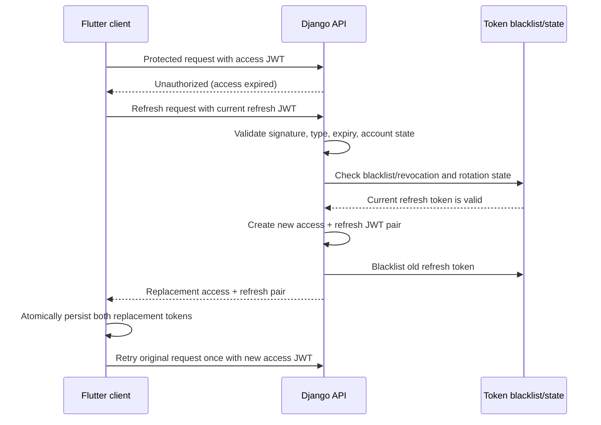

# 04 - Authentication Session and JWT Lifecycle

**Status:** Draft for review  
**Parent:** [IAM Architecture](README.md)

## 1. Purpose

Define the AMS token model and the lifecycle rules for establishing, maintaining, and terminating authenticated API access.

## 2. Token model

AMS mobile clients use a conventional pair:

- **Access JWT:** short-lived credential presented to protected API endpoints.
- **Refresh JWT:** longer-lived credential presented to the refresh endpoint to obtain a replacement access/refresh pair.

This is not a sliding-token design. The refresh token is rotated; the access and refresh tokens are separate credentials with separate purposes and lifetimes.

## 3. Agreed policy baseline

| Policy | Current decision |
|---|---|
| Access token lifetime | Configurable; proposed default 10 minutes. |
| Refresh token inactivity lifetime | 14 days from the latest successful rotation. |
| Refresh rotation | Enabled. Each successful refresh issues a replacement refresh token. |
| Previous refresh token | Blacklisted/rejected after successful rotation. |
| Refresh-token reuse | Rejected; replay/reuse must not restore an earlier token. |
| Absolute maximum session lifetime | Not required for initial release; deferred security enhancement. |
| Client storage | Both tokens stored in platform-appropriate secure storage. |
| Client retry | Retry an unauthorized request at most once after a successful refresh. |

The 14-day value is an inactivity window, not an absolute session lifetime. A successful refresh renews the inactivity window. Since no absolute maximum is enforced initially, a continuously refreshed session may continue beyond 14 days. This limitation must remain visible in security documentation and release notes.

## 4. Logical lifecycle

```mermaid
stateDiagram-v2
  [*] --> Unauthenticated
  Unauthenticated --> Authenticated: Successful AMS authentication
  Authenticated --> Active: Access + refresh pair issued
  Active --> Active: Valid access-token API request
  Active --> Refreshing: Access expired / refresh required
  Refreshing --> Active: Refresh accepted; new pair stored
  Refreshing --> ReauthenticationRequired: Refresh expired / blacklisted / invalid
  Active --> Revoked: Logout or administrative revocation
  Active --> ReauthenticationRequired: Account becomes ineligible
  Revoked --> Unauthenticated
  ReauthenticationRequired --> Unauthenticated
  Unauthenticated --> [*]
```

This is a logical client/session state model. It does not assert that every state is persisted as a database row.

## 5. Authentication and token issuance

After the backend completes Google identity verification and AMS account eligibility checks:
1. Resolve the AMS account and its current state.
2. Confirm the account is permitted to authenticate.
3. Issue a short-lived access JWT and refresh JWT.
4. Return both credentials over HTTPS.
5. The client stores both credentials securely and treats the backend response as authoritative.

JWT claims, signing algorithm/key management, token type separation, issuer/audience configuration, and key rotation must be specified in backend configuration/API security documentation. A token's presence in the client is not proof that it remains valid or authorized.

## 6. Refresh and rotation

Requirements:
- Rotation must be enforced server-side.
- The old refresh token must not remain usable after successful rotation.
- The replacement refresh token receives a fresh 14-day inactivity expiry.
- Concurrent refresh attempts must not result in multiple valid descendants from the same refresh token. Use appropriate atomicity/locking or equivalent replay-safe handling.
- If a rotated/blacklisted token is reused, reject it. Any broader token-family revocation response must be explicitly defined and tested.
- The client must replace both stored tokens together; it must not retain the old refresh token after a successful rotation.
- The client should coordinate refresh requests (single-flight) to avoid concurrent refresh races.
- Retry the failed API request at most once; do not loop indefinitely on 401 responses.

## 7. Expiration semantics

### Access token
The access token has a short configurable lifetime. Expiration requires a successful refresh or reauthentication.

### Refresh token inactivity
The refresh token expires 14 days after its issuance, which is renewed on each successful rotation. If no successful rotation occurs within that period, reauthentication is required.

### Absolute session lifetime
There is no absolute maximum session lifetime in the initial release. Refresh rotation alone does not impose an absolute boundary. Record an absolute lifetime as a future hardening enhancement; do not imply that the 14-day inactivity window provides it.

## 8. Logout and revocation

Logout must:
- Revoke/blacklist the current refresh credential on the backend where the API contract supports it.
- Clear both access and refresh tokens from secure local storage.
- Clear user-specific cached data and prevent account-switch data leakage.
- Return the client to an unauthenticated state.

Administrative revocation and account deactivation must prevent continued refresh. Access JWTs may remain cryptographically valid until expiry unless the backend adds an online revocation/account-state check or another explicit access-token invalidation mechanism. The chosen behavior and maximum residual access window must be documented and tested.

## 9. Operational and security requirements

- Never log token values or authorization headers.
- Use HTTPS in production.
- Keep signing keys outside source control and rotate exposed keys.
- Validate token type, signature, issuer/audience where configured, expiry, and account eligibility.
- Use blacklist/revocation storage that is durable and shared across backend instances.
- Monitor refresh failures and suspicious reuse without recording token secrets.
- Ensure mobile secure storage and token replacement behavior are tested on supported platforms.

## 10. Verification scenarios

At minimum test:
- Valid access token; expired access token.
- Valid refresh token; expired refresh token.
- Successful refresh and replacement of both tokens.
- Reuse of the old rotated refresh token.
- Concurrent refresh requests.
- Logout and refresh after logout.
- Account deactivation/revocation and subsequent refresh.
- 14-day inactivity boundary.
- Client restart with valid and invalid stored credentials.
- One-time retry behavior and prevention of infinite refresh loops.
