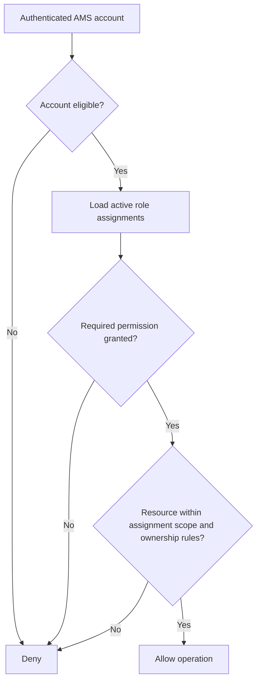

# 05 - Authorization Model

**Status:** Draft for review  
**Parent:** [IAM Architecture](README.md)

## 1. Purpose

Define how AMS decides whether an authenticated account may perform an operation on a particular resource. Authentication establishes the principal; authorization evaluates that principal's roles, permissions, account state, and resource scope.

## 2. Authorization approach

AMS uses role-based access control (RBAC) supplemented by scoped assignments and object-level authorization.

A simplified decision is:

`Allow = Authenticated AND AccountEligible AND HasRequiredPermission AND WithinAllowedScope`

A valid JWT is necessary for protected authenticated operations but is not sufficient by itself.

Django is the authoritative enforcement point. Flutter may hide or show features for usability, but those UI decisions never replace backend checks.

## 3. Roles

The initial role set is:

| Role | Intended responsibility |
|---|---|
| Student | Student-facing academic and attendance functions for permitted resources belonging to that student. |
| Lecturer | Teaching, course, and class-session operations within assigned teaching scope. |
| Administrator | System administration, account provisioning, and other explicitly granted administrative capabilities. |
| HOD | Departmental oversight and approval workflows, including student absence/excuse decisions within the HOD's department and assigned scope. |

An account may hold multiple roles. Role assignment must be managed by authorized backend workflows and must not be accepted from client input or Google profile claims.

## 4. Roles are not a hierarchy

Do not assume that one role automatically inherits another role's permissions.

In particular:
- HOD is a distinct role, not an alias for Administrator.
- HOD does not automatically receive every Administrator permission.
- An HOD may receive selected administrative permissions through explicit grants.
- Such grants should be constrained to the HOD's authorized department or resource scope where applicable.
- Administrator permissions must also be explicit; the label alone should not bypass policy checks or audit requirements.

This allows controlled overlap without creating an implicit privilege-escalation path.

## 5. Conceptual authorization model

A role assignment may be global or scoped. The exact scope model must be finalized against AMS organizational and academic entities. Expected examples:
- HOD approval permissions scoped to the HOD's department.
- Lecturer session/course permissions scoped to assigned course offerings or sessions.
- Student access scoped to the student's own account, enrollments, attendance, and related records.
- Administrative permissions scoped according to the operation and administrative authority.

## 6. Initial authorization matrix

This matrix is a policy baseline, not a complete endpoint specification. Exact permissions and resource scopes must be mapped to each API endpoint before release.

| Capability | Student | Lecturer | HOD | Administrator |
|---|---:|---:|---:|---:|
| Access own permitted profile | Yes | Yes | Yes | Yes, when explicitly permitted |
| View own attendance | Yes | As applicable | As applicable | As applicable |
| Mark attendance through student flow | Yes, subject to enrollment/session rules | No, unless separately authorized | No, unless separately authorized | No, unless separately authorized |
| Manage assigned teaching sessions | No | Yes, within assigned scope | Only if separately granted | Only if separately granted |
| Review student absence/excuse requests | No | No, unless policy explicitly grants a role | Yes, within department scope | Only if explicitly granted |
| Provision lecturer accounts | No | No | Only if explicit delegated permission is granted | Yes, with dedicated permission |
| Assign or change privileged roles | No | No | Only if explicitly and narrowly delegated | Yes, with dedicated permission |
| Manage global IAM/security configuration | No | No | No by default | Only designated administrator permissions |

“Only if explicitly granted” is not an implied default. The permission must be named, assigned through an authorized workflow, scoped, and audited.

## 7. Object-level authorization rules

At minimum, enforce the following rules in backend services and query paths:

- A student can access only their own student-specific records and resources for which they have an explicit entitlement, such as an active enrollment.
- A lecturer can manage only course offerings and sessions assigned to them, subject to the relevant academic policy.
- An HOD can review/approve only requests within the HOD's authorized departmental scope.
- An HOD's delegated administrative capability cannot be used outside its assigned scope.
- An administrator can perform only operations covered by the administrator's assigned permissions; high-impact operations should have dedicated permissions.
- Changing an object ID in a request must never grant access to another user's or department's resource.

Use deny-by-default behavior when the resource owner, assignment, scope, or policy cannot be established.

## 8. Enforcement points

- Apply authentication requirements to protected API endpoints.
- Use explicit DRF permission classes for role/capability checks.
- Enforce object-level checks in the service/view/query path; do not assume a view-level role check is sufficient.
- Filter querysets by the authenticated principal's authorized scope to reduce accidental data exposure.
- Protect role assignment, lecturer provisioning, activation, and other privileged operations with dedicated permissions.
- Treat Flutter navigation guards as user experience only.

## 9. Audit requirements

Record security-relevant events, including:
- Role and permission assignment/revocation.
- Lecturer provisioning and activation.
- HOD approval/denial decisions.
- Administrative actions on user accounts.
- Authorization denials for sensitive operations where useful.
- Changes to departmental/resource scope.

Audit records should identify the actor, action, target, outcome, timestamp, and relevant correlation/context identifiers. Do not include passwords, raw JWTs, Google ID tokens, activation secrets, or sensitive request bodies.

## 10. Open decisions

- Final list of permissions and permission codes.
- Which administrative capabilities, if any, can be delegated to HODs.
- Whether delegation is role-permission based, account-specific, or both.
- Canonical department and academic-resource scope relationships.
- Whether any high-impact actions require additional approval or separation of duties.
- Exact endpoint-to-permission matrix and corresponding negative tests.
